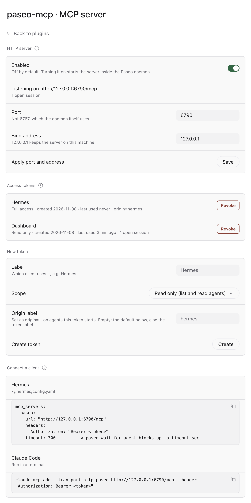
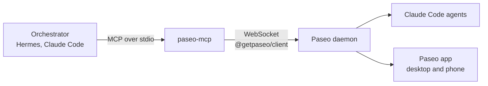
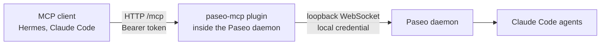

<div align="center">

# Paseo MCP

**Let an orchestrator agent see and steer your Paseo agents.**

An MCP server that gives Hermes, Claude Code or any other MCP client access to the coding agents running in your local Paseo: list them, read what they did, start new ones, send follow-ups, wait for results, answer permission requests.

[](https://paseo.sh)
[](https://modelcontextprotocol.io)
[](https://nodejs.org)
[](LICENSE)

</div>

---

## Why

Paseo is a great place to run many Claude Code chats side by side, but it is built for a human in front of the app. When you want one agent to hand work to others (an assistant that reads your mail and starts a coding agent for a bug report, or a lead agent that splits a task), that agent needs a way into Paseo.

This server is that way in. Everything it starts is a normal Paseo chat: you see it in the app, on your phone, and can take over at any time.

It runs in one of two ways, with the same ten tools:

| | stdio | Paseo plugin |
|---|---|---|
| Runs as | a child process of your MCP client | part of the Paseo daemon |
| Transport | stdin/stdout | Streamable HTTP at `http://127.0.0.1:6790/mcp` |
| Configured in | `~/.config/paseo-mcp/config.json` | Settings → Plugins → paseo-mcp |
| Access | whoever can start the process | a bearer token per client, scoped `read` or `full` |
| Set up | [Install](#install) | [Plugin mode](#plugin-mode) |

## Features

|  |  |
|---|---|
| **Overview** | List agents with status, account, and whether they need you (finished, failed, waiting for a permission). |
| **Readable transcripts** | The tail of a chat as a compact transcript: user, agent, tool calls, todos, errors. |
| **Start agents** | New Claude Code chats with a first prompt, model, thinking level, permission mode, account and optional git worktree branch. |
| **Steer running agents** | Send follow-ups; for a running turn choose *steer* (inject) or *interrupt* (restart with the message). |
| **Wait for results** | Block until a turn ends, fails, or needs a permission, and get the final message back. |
| **Guard rails** | Agents only start inside `allowedRoots`, everything gets an `origin` label, a read-only mode, and agent output is marked as data, not instructions. |
| **Paseo plugin** | Optional: serve the tools over HTTP from inside Paseo, with per-client tokens and a settings screen. |

## Tools

| Tool | What it does |
|---|---|
| `paseo_list_agents` | Agents with status, account, attention flag. Filters: status, labels, archived |
| `paseo_get_agent` | One agent's state including pending permission requests |
| `paseo_read_timeline` | Last N timeline entries as a compact transcript |
| `paseo_list_accounts` | The Claude accounts from your config |
| `paseo_list_models` | Models of a provider as `claude/<model-id>` |
| `paseo_create_agent` | Start a new agent (cwd must be inside `allowedRoots`) |
| `paseo_send_message` | Send a follow-up (`when_running`: `steer` or `interrupt`) |
| `paseo_wait_for_agent` | Wait until the turn is done, failed, needs a permission, or times out |
| `paseo_respond_permission` | Allow or deny a permission request |
| `paseo_archive_agent` | Archive a finished agent |

Agent ids can be passed in full or as a unique prefix, like the short ids `paseo ls` shows. In read-only mode, and for plugin tokens with the `read` scope, only the first five tools exist.

## Requirements

- [Paseo](https://paseo.sh) **0.15 or newer**, running (desktop app or `paseo daemon start`)
- Node **22 or newer**
- For plugin mode: plugins enabled in Paseo, and `npm` on the daemon's `PATH` (Paseo runs `npm ci` once on install)
- An MCP client: [Hermes](https://hermes-agent.nousresearch.com), [Claude Code](https://docs.anthropic.com/en/docs/claude-code), …

## Install

```sh
git clone https://github.com/MaxGierlachowski/paseo-mcp.git
cd paseo-mcp
npm install          # also builds dist/

mkdir -p ~/.config/paseo-mcp
cp config.example.json ~/.config/paseo-mcp/config.json
```

Then edit `~/.config/paseo-mcp/config.json` (see below) and connect your client.

### Hermes

`~/.hermes/config.yaml`:

```yaml
mcp_servers:
  paseo:
    command: "node"
    args: ["/path/to/paseo-mcp/dist/index.js"]
    env:
      PASEO_MCP_CONFIG: "/Users/<you>/.config/paseo-mcp/config.json"
    timeout: 300          # paseo_wait_for_agent blocks up to timeout_sec
    connect_timeout: 30
```

Hermes only passes `PATH` and `HOME` to MCP servers; anything else belongs under `env`.

### Claude Code

```sh
claude mcp add paseo -- node /path/to/paseo-mcp/dist/index.js
```

## Configuration

`~/.config/paseo-mcp/config.json` (another path via `PASEO_MCP_CONFIG`):

| Key | Default | Meaning |
|---|---|---|
| `daemonUrl` | `ws://127.0.0.1:6767/ws` | WebSocket of the Paseo daemon |
| `password` | – | Daemon password, if set. `PASEO_PASSWORD` wins |
| `allowedRoots` | **required** | Agents may only start inside these folders (symlinks resolved) |
| `defaultProvider` | – | `provider/model`, e.g. `claude/claude-sonnet-5-5`. Check with `paseo_list_models` |
| `defaultThinking` | – | e.g. `low`, `medium`, `high` |
| `defaultMode` | – | Permission mode: `auto`, `default`, `acceptEdits`, `plan` |
| `accounts` | `{}` | Name → `{ configDir, note? }`, one entry per Claude login |
| `defaultAccount` | – | Account used when the caller names none |
| `accountEnvVar` | `CLAUDE_CONFIG_DIR` | Env var set on new agents to the account's `configDir` |
| `originLabel` | `hermes` | Value of the `origin` label on every agent this server starts |
| `readOnly` | `false` | Only list/read tools. Also `PASEO_MCP_READONLY=1` |

### Accounts and paseo-multi-account

When an agent is started with an account, the server sets `accountEnvVar` to that account's `configDir` for the new agent and adds the label `account=<name>`. With the default `CLAUDE_CONFIG_DIR`, Claude Code runs on exactly that login.

If you use [paseo-multi-account](https://github.com/MaxGierlachowski/paseo-multi-account), the plugin already decides which login Claude runs on and moves chats when you switch. Let it stay in charge: set `accountEnvVar` to a name Claude Code ignores (e.g. `PASEO_CLAUDE_ACCOUNT`). The account then only becomes a label you can filter by, and the plugin's switch applies to agents started over MCP like to any other chat.

## Plugin mode

Installed as a Paseo plugin, paseo-mcp serves the same tools over [Streamable HTTP](https://modelcontextprotocol.io/specification/2025-06-18/basic/transports#streamable-http) from inside the Paseo daemon. There is no process to start and no config file: everything is set on the plugin's settings screen. The stdio mode above keeps working unchanged next to it.

<p align="center"></p>

### Install

```sh
paseo plugin install github:MaxGierlachowski/paseo-mcp
```

On macOS the CLI ships inside the app: `/Applications/Paseo.app/Contents/Resources/bin/paseo`. Paseo asks you to trust the plugin (plugins run unsandboxed), clones it, runs `npm ci --omit=dev` and loads it. Plugins must be enabled (`"pluginsEnabled": true` in `~/.paseo/config.json`). The HTTP server stays **off** until you turn it on.

If another plugin already uses the id `paseo-mcp`, Paseo refuses the install; remove that one first or pass `--id`.

### Set up

1. Open the settings: ⌘K → **MCP server**, or Settings → Plugins → paseo-mcp.
2. Under **Agents**, add the folders agents may start in (`allowedRoots`). Without one, `paseo_create_agent` refuses every start.
3. Under **New token**, create one token per client: a label (e.g. `Hermes`), a scope, optionally an origin label. Copy the token; it is shown **once**.
4. Turn on **Enabled**. The status row shows the URL, or why the server could not start (e.g. the port is taken).
5. Copy the snippet for your client from **Connect a client**.

| Setting | Default | Meaning |
|---|---|---|
| Enabled | off | Run the HTTP server inside the daemon |
| Port | `6790` | Any free port except the daemon's own `6767` |
| Bind address | `127.0.0.1` | Anything else makes the server reachable from your network; the screen warns |
| Tokens | – | Label, scope (`read` or `full`), optional origin label. Stored as SHA-256 hashes |
| Read-only | off | Only the list/read tools, for every token |
| Allowed roots | – | Folders agents may start in (symlinks resolved) |
| Provider, Thinking, Permission mode | – | Defaults for new agents, like `defaultProvider`, `defaultThinking`, `defaultMode` |
| Origin label | token label | `origin=…` on agents started by tokens without their own origin label |
| Account env var | `CLAUDE_CONFIG_DIR` | Like `accountEnvVar` above |
| Claude accounts, default account | – | Like `accounts` and `defaultAccount` above |

Changes apply at once: port, bind address and the switch restart the listener; everything else is read on the next tool call. The daemon connection needs no setup: the plugin reaches its own daemon over loopback with the local credential Paseo writes to `$PASEO_HOME/local-credential`, the way the `paseo` CLI does.

### Connect

Hermes, in `~/.hermes/config.yaml`:

```yaml
mcp_servers:
  paseo:
    url: "http://127.0.0.1:6790/mcp"
    headers:
      Authorization: "Bearer <token>"
    timeout: 300          # paseo_wait_for_agent blocks up to timeout_sec
```

Claude Code:

```sh
claude mcp add --transport http paseo http://127.0.0.1:6790/mcp --header "Authorization: Bearer <token>"
```

Any other client: Streamable HTTP, URL `http://127.0.0.1:6790/mcp`, header `Authorization: Bearer <token>`.

### Security model

- **Off by default.** Turned on, the server binds to `127.0.0.1`. Other addresses must be entered explicitly and come with a warning on the screen.
- **A token on every request**, also from localhost. Missing or wrong: `401`. Tokens are 32 random bytes (`pmcp_…`), stored only as SHA-256 hashes with `createdAt`, compared in constant time. When a token was last used is kept in `$PASEO_HOME/paseo-mcp.json`.
- **Revoking** a token removes its hash; its next request gets `401` and its open sessions are closed at once.
- **Scopes.** A session registers only the tools of its token's scope: `read` gets the five list/read tools, `full` all ten. The global read-only switch applies on top.
- **Sessions belong to their token.** A session id used with another token is answered like an unknown one.
- **DNS rebinding.** The `Host` header must name the server itself (loopback names, or the bind address) and an `Origin` header, if sent, must point at it too; otherwise `403`. Request bodies are capped at 1 MiB (`413`).
- **Same guard rails as stdio.** `allowedRoots` is checked on the daemon side, every started agent gets `origin=<token's origin label>`, and permission requests are never answered automatically.

## How it works



1. The client starts `paseo-mcp` as a child process and talks MCP over stdin/stdout.
2. On the first tool call the server connects to the Paseo daemon with the official client library and reconnects if the daemon restarts.
3. Tool calls map one to one onto the daemon's agent API (`agents.list`, `create`, `send`, `waitForFinish`, …). The server keeps no state of its own.
4. Before an agent starts, `cwd` is resolved (including symlinks) and checked against `allowedRoots`; account env, `origin` and `account` labels are attached.

In plugin mode the client talks Streamable HTTP to the plugin, which runs inside the daemon and opens one McpServer per session:



## Security

Starting agents with repository and tool access is powerful. Keep in mind:

- Text from mail, tickets or web pages is untrusted input. Have your orchestrator ask you before it starts an agent from such content, and never pass it through unfiltered as a prompt.
- Transcripts and final messages are returned with a note to treat them as data, not instructions.
- Only let the orchestrator call `paseo_respond_permission` with `allow` after you confirmed, unless the request is clearly read-only.
- To start, use `readOnly: true` and let the orchestrator only watch.

## Development

```sh
npm run build                          # compile server/ to dist/
npm test                               # build, then unit and HTTP integration tests
npm run typecheck                      # the plugin entry points and settings screen
PASEO_MCP_CONFIG=~/.config/paseo-mcp/config.json \
  npm run smoke -- paseo_list_accounts 'paseo_list_agents={"limit":5}'
```

`smoke.mjs` starts the server like an MCP client would and calls the tools you name (`tool=<json args>`).

Layout: `server/` holds the tools (`tools.ts`), the HTTP transport (`http.ts`, `auth.ts`) and the stdio entry (`index.ts`, built to `dist/index.js`); `server/plugin/` the daemon side of the plugin; `shared/` the settings and RPC contracts; `client/` the settings screen. `index.server.ts` and `index.client.tsx` are the plugin entry points, compiled by Paseo itself. To try the plugin from a checkout, run `npm ci --omit=dev --ignore-scripts` in a copy of it (a directory install skips the build step) and `paseo plugin install <dir>`; test against a separate daemon with `--home <tmp-dir>` rather than your everyday one.

Tested against Paseo daemon 0.15 and `@getpaseo/client` 0.15.

## License

[Apache 2.0](LICENSE)
